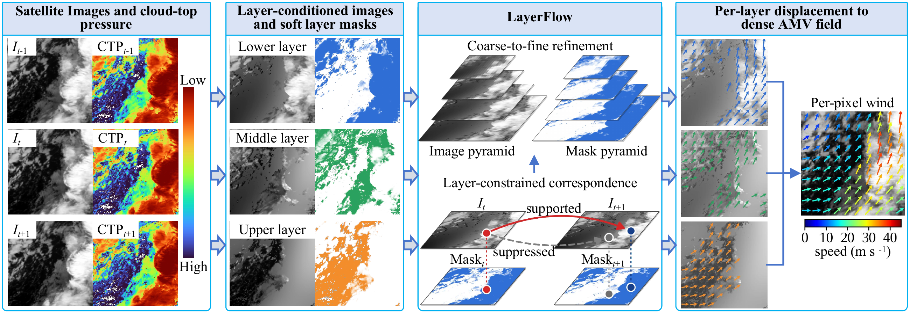
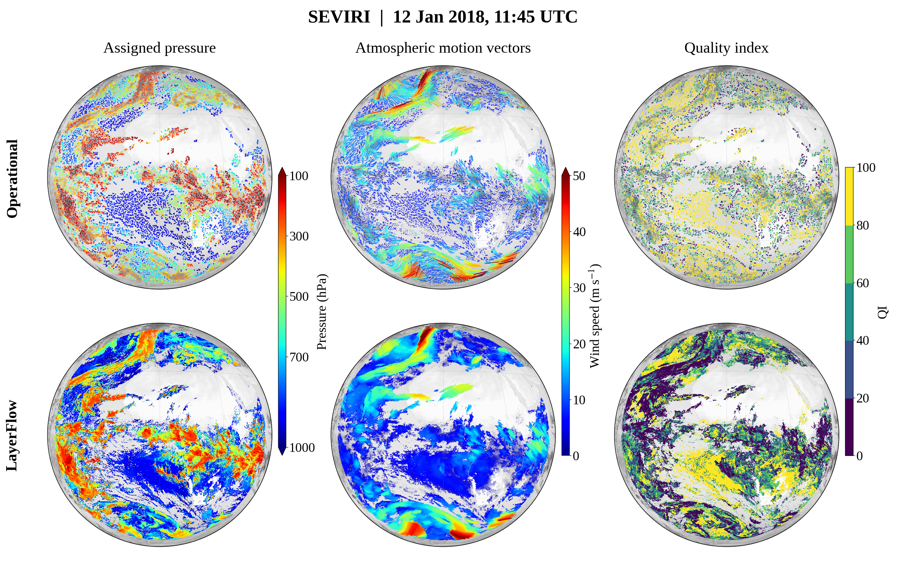
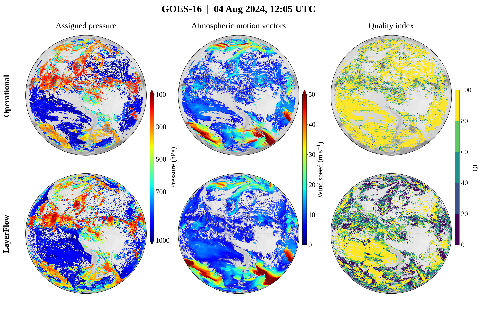

# LayerFlow

LayerFlow retrieves dense atmospheric motion vectors using layer-constrained
optical flow. Cloud-top pressure and soft layer masks guide motion estimation,
while a self-supervised quality indicator (QI) accounts for tracking and
pressure-assignment uncertainty. The workflow is illustrated below.



## Install

From the repository root, create and activate a Conda environment:

```bash
conda create -n layerflow python=3.10 pip -y
conda activate layerflow
python -m pip install -r requirements.txt
```

PyTorch is used by the self-supervised QI model.
For GPU use, install the appropriate wheel following the
[PyTorch instructions](https://pytorch.org/get-started/locally/).
Use `opencv-contrib-python-headless` for OpenCV.

### Build the native module

Install Git, CMake, Ninja and a C/C++ compiler. On Windows, use a 64-bit
MinGW-w64 toolchain, for example [MSYS2 UCRT64](https://www.msys2.org/), and make
`gcc`, `g++`, `cmake` and `ninja` available on PATH.

```bash
python tools/build_pressure_conditioned_flow_native.py --fetch-opencv --jobs 4
```

For an explicit Windows MinGW/Ninja build:

```powershell
python tools/build_pressure_conditioned_flow_native.py --fetch-opencv --generator Ninja --c-compiler gcc --cxx-compiler g++ --jobs 4
```

The script obtains OpenCV 4.13.0 source and builds the included masked
variational-refinement module under `_third_party/`. If you already have that
source checkout, use `--opencv-source PATH`.
`AMV_PRESSURE_CONDITIONED_OPENCV_DIR` optionally selects another compatible
installation. Windows DLLs and Linux shared libraries are discovered automatically.

## Data access and credentials

### EUMETSAT: SEVIRI, OCA and operational AMVs

1. Create an account at the [EUMETSAT EO Portal](https://eoportal.eumetsat.int/).
2. Sign in to [API Key Management](https://api.eumetsat.int/api-key/) and obtain
   your **Consumer Key** and **Consumer Secret**.
3. Browse and download products through the [Data Store](https://data.eumetsat.int/),
   or install the official client and configure the pair:

```bash
python -m pip install eumdac
eumdac set-credentials YOUR_CONSUMER_KEY YOUR_CONSUMER_SECRET
```

See the
[official client guide](https://user.eumetsat.int/resources/user-guides/eumetsat-data-access-client-eumdac-guide).

Select SEVIRI level-1.5 native imagery (IR 10.8 micrometres), corresponding OCA
cloud products and, for operational comparisons, the AMV product:

| Product | Data Store collection | Place extracted files in |
|---|---|---|
| SEVIRI level 1.5 | `EO:EUM:DAT:MSG:HRSEVIRI` | `data/seviri_example/eumetsat_seviri_l15/native/` |
| OCA cloud properties | `EO:EUM:DAT:0617` | `data/seviri_example/eumetsat_oca/native/` |
| Operational AMVs | `EO:EUM:DAT:0405` | `data/seviri_example/eumetsat_amv/native/` |

Download four consecutive SEVIRI observations and four matching OCA products
from the same satellite and navigation grid. Keep the original filenames and
native/NetCDF formats. Nested extraction folders are supported.
Download operational AMVs for comparisons with the operational product.

### GOES ABI and operational DMW

The [NOAA GOES archive](https://registry.opendata.aws/noaa-goes/) is public and
does **not** require an AWS account or API key. Use the appropriate satellite
bucket, such as `noaa-goes16` or `noaa-goes18`. You can browse the archive or use
unsigned AWS CLI requests:

```bash
python -m pip install awscli
aws s3 ls --no-sign-request s3://noaa-goes18/ABI-L2-CMIPF/
```

Choose a center full-disk scan and its preceding/following scans. Download
Band-14 imagery and the matching cloud products for all three roles:

| Product | Local folder below `data/goes_example/goes16/` or `goes18/` |
|---|---|
| Band-14 brightness temperature | `ABI-L2-CMIPF-C14/` (S3 prefix `ABI-L2-CMIPF`, select C14) |
| Cloud-top pressure | `ABI-L2-ACHP2KMF/` |
| Cloud-top height | `ABI-L2-ACHA2KMF/` |
| Cloud mask | `ABI-L2-ACMF/` |

Operational center-scan DMW files, when needed for comparisons, go under
`data/goes_example/official_amv/goes16/ABI-L2-DMWF-C14/` or the corresponding
`goes18/` directory. All products for a role must refer to the same scan and
compatible fixed grid.

Generate the reader manifest from the downloaded filenames. Replace
`CENTER_UTC` with the center scan midpoint in ISO 8601 format:

```bash
python tools/prepare_goes_manifest.py data/goes_example --center CENTER_UTC --satellites G16
```

The resulting `manifests/goes_selected_products.csv` maps local files to their
roles. Its default cadence is ten minutes. The scan midpoint and scan start are
different timestamps; choose the midpoint for `--center`.
Use `--satellites G16 G18` when preparing both satellite views, or `G18` alone.

### ERA5

Download ERA5 winds for reference evaluation.

1. Register/sign in to the [Climate Data Store](https://cds.climate.copernicus.eu/).
2. Open the [API setup page](https://cds.climate.copernicus.eu/how-to-api) and copy
   your **Personal Access Token**.
3. Create `.cdsapirc` in your home directory (`%USERPROFILE%\.cdsapirc` on Windows,
   `~/.cdsapirc` on Linux) with the following contents:

```yaml
url: https://cds.climate.copernicus.eu/api
key: YOUR_PERSONAL_ACCESS_TOKEN
```

4. Open [ERA5 hourly pressure-level data](https://cds.climate.copernicus.eu/datasets/reanalysis-era5-pressure-levels),
   accept the dataset terms, and select the variables, region and times for your
   observations. The download form's **Show API request code** provides a request
   matching your selections.

```bash
python -m pip install "cdsapi>=0.7.7"
```

Request eastward/northward wind (`u`, `v`) and geopotential (`z`) on pressure
levels covering the cloud pressures in your scene. Include hourly times before
and after the observations and sufficient spatial coverage for interpolation.
Use NetCDF. For SEVIRI place the file under `data/seviri_example/era5/`.
The GOES evaluator accepts separate non-wrapping domains under
`data/goes_example/era5/<region>/`; each region needs one file named
`era5_*_pressure_levels.nc`. Region names are arbitrary and their actual coverage
is read from the files.

### Radiosondes, coastlines and optional operational QI

- [NOAA NCEI IGRA](https://www.ncei.noaa.gov/products/weather-balloon/integrated-global-radiosonde-archive):
  public station data, no API key. Place `igra2-station-list.txt` in `data/igra/`
  and station `*-data.txt.zip` files in `data/igra/stations/`.
- [Natural Earth coastlines](https://www.naturalearthdata.com/downloads/50m-physical-vectors/50m-coastline/):
  public download, no API key. Place the `ne_50m_coastline` shapefile components
  (`.shp`, `.shx`, `.dbf`) in `data/natural_earth/`.
- [NOAA NASA Joint Archive](https://psl.noaa.gov/data/nnja_obs/): optional GOES
  operational QI comes from GDAS satellite-wind BUFR. Public DMW NetCDF contains
  DQF rather than the forecast-independent QI. Download the relevant dump for
  your observation period. The exporter needs `pybufrkit==0.2.25`,
  `bitstring==3.1.9`, `loguru`, and the separately downloaded upstream NVIDIA
  [BUFR helper](https://github.com/NVIDIA/earth2studio/blob/main/earth2studio/data/utils_bufr.py).
  Use `python tools/export_goes_qi.py --help` to set your input file and time
  window. Place its `*_qi.csv` output in `data/goes_example/official_amv_qi/`.

## Data directories

Place downloaded data in the following directories. Use the same layout for
additional datasets.

```text
data/
  seviri_example/
    eumetsat_seviri_l15/native/
    eumetsat_oca/native/
    eumetsat_amv/native/
    era5/
  goes_example/
    goes16/<four ABI product folders>/
    goes18/<four ABI product folders>/
    official_amv/goes16/ABI-L2-DMWF-C14/
    official_amv/goes18/ABI-L2-DMWF-C14/
    official_amv_qi/
    manifests/
    era5/<region folders>/
  igra/stations/
  natural_earth/
```

## Run the workflow

Run commands from the repository root. The processing sequence is:

1. Read the images and cloud products, construct pressure-conditioned layers,
   and estimate temporal flow components.
2. Convert flow to wind, combine the components, assign cloud-top pressure,
   and save the AMV products. Both LayerFlow entry scripts perform these steps.
3. Fit the self-supervised error model and compute tracking/pressure QI.
4. Optionally collocate the AMVs with ERA5 or radiosondes for evaluation.

The examples below cover retrieval through QI, followed by optional evaluation.

### Example A: SEVIRI

After placing four image/OCA pairs in `data/seviri_example/`, run the following,
replacing `FIRST_FRAME_UTC` with the first frame time in ISO 8601 format, such as
`YYYY-MM-DDTHH:MM:SS`. `--case` names the output folder.

```bash
python scripts/run_layerflow_seviri.py --case seviri_example --data-dir data/seviri_example --start FIRST_FRAME_UTC --interval-minutes 15 --threads 4
```

Add `--aoi WEST EAST SOUTH NORTH` to select a geographic region, for example
`--aoi -10 -6 40 44`. Omit `--aoi` to process the full disk.

This command estimates C1/C2/C3 from the adjacent image pairs. Each component
uses its source-frame OCA pressure grid (P0/P1/P2); valid component pressures
are averaged for the final AMV. It saves the dense wind and pressure-assigned
products together. Observation paths, times and the region are recorded in
`outputs/seviri_example/run_inputs.json` for downstream processing.

Next, compute QI:

```bash
python scripts/run_quality_control.py seviri_example pressure_conditioned_flow
```

The main output files are:

```text
outputs/seviri_example/
  trackers/pressure_conditioned_flow/final/pressure_conditioned_flow_final_native.npz
  pressure_assignment/pressure_conditioned_flow_final_amv_oca_pressure.npz
  qc_selfsup/pressure_conditioned_flow/pressure_conditioned_flow_selfsup_qc.npz
  run_inputs.json
```

The compact AMV file contains location, wind and `pressure_hpa`. The QI file
contains `row_center_original`/`col_center_original`, `quality_index` (0–100)
and error estimates, so its scores
can be matched to the retrieved vectors by pixel coordinates.

### Example B: GOES

After creating the manifest for your chosen scans:

```bash
python scripts/run_layerflow_goes.py --case goes_example --data-dir data/goes_example --satellites G16 --threads 4
python scripts/run_quality_control.py goes_example pressure_conditioned_flow --sat G16
```

The retrieval estimates center-to-previous and center-to-next flow, averages
both wind components, and assigns center-scan ABI cloud-top pressure. It saves
surface and cloud-height-corrected geometry variants; QI uses the latter.
GOES cloud-top height supplies the parallax correction.

```text
outputs/goes_example/
  trackers/pressure_conditioned_flow_g16/final/
    pressure_conditioned_flow_g16_cloud_height_final_native.npz
    pressure_conditioned_flow_g16_surface_final_native.npz
  pressure_assignment/
    pressure_conditioned_flow_g16_cloud_height_final_amv_goes_pressure.npz
    pressure_conditioned_flow_g16_surface_final_amv_goes_pressure.npz
  qc_selfsup/pressure_conditioned_flow_g16/pressure_conditioned_flow_g16_selfsup_qc.npz
  run_inputs.json
```

Use `--satellites G16 G18` for both prepared views, then run the QI command
once with `--sat G16` and once with `--sat G18`. For G18 alone, select G18
in the manifest, retrieval and QI commands.

Pressure bounds use hPa.
Numerical settings are grouped near the top of the entry scripts. Use
`--output-dir` to choose the retrieval destination. Downstream scripts use the
`outputs/<case>/` layout. Use `--help` to list LayerFlow command-line options.

### Evaluate against ERA5 (optional)

After downloading ERA5 into the directories above, evaluate the pressure-assigned
AMVs. Set `AMV_CASE` for the SEVIRI evaluator:

```bash
export AMV_CASE=seviri_example
python scripts/evaluate_era5_seviri.py
python scripts/run_quality_control.py seviri_example --rescore pressure_conditioned_flow
```

In PowerShell, use `$env:AMV_CASE = "seviri_example"` in place of `export`.
When operational AMV files are present, the SEVIRI evaluator includes them in
the comparison. Retrieved AMVs can also be evaluated with ERA5 alone.

For GOES:

```bash
python scripts/evaluate_era5_layerflow_goes.py --case goes_example --satellites G16
python scripts/run_quality_control.py goes_example --rescore pressure_conditioned_flow --sat G16
```

The GOES evaluator reuses the saved observation directory and satellite
selection. Use `--data-dir PATH` to select another directory containing ERA5,
or `--satellites G16 G18` to evaluate both prepared views.

Evaluation writes collocation caches and metric CSVs under
`outputs/<case>/comparison/amv_vs_era5/` (SEVIRI) or
`outputs/<case>/goes_pcf_vs_era5/` (GOES). After evaluation, `--rescore`
reuses the fitted error statistics to refresh QI and produce ERA5 retention
and reliability curves under `qc_selfsup/<tracker>/`.

## Example results

Operational products (top) and LayerFlow (bottom): assigned pressure, AMVs and QI.

### SEVIRI



### GOES-16



## Baselines, evaluation and plotting

Install additional dependencies when running baselines (including scikit-image
for TV-L1 and iterative Lucas-Kanade):

```bash
python -m pip install -r requirements-baselines.txt
```

For FlowDiffuser and WindFlow, download the authors' code:

```bash
git clone https://github.com/LA30/FlowDiffuser external/FlowDiffuser
git clone https://github.com/tjvandal/windflow external/windflow
```

Obtain the authors' checkpoints and place them at
`weights/FlowDiffuser-things.pth` and `weights/windflow.raft.pth.tar`, or set
`AMV_FLOWDIFFUSER_REPO`, `AMV_FLOWDIFFUSER_CHECKPOINT`, `AMV_WINDFLOW_REPO`, and
`AMV_WINDFLOW_CHECKPOINT` to your own locations.

DeepFlow and Farneback use OpenCV, with output names ending in `_opencv`.

Traditional SEVIRI baselines accept the same observation options as LayerFlow:

```bash
python scripts/run_baselines_seviri.py --case seviri_example --data-dir data/seviri_example --start FIRST_FRAME_UTC --interval-minutes 15 --threads 4
python scripts/run_baselines_seviri_layered.py --case seviri_example --data-dir data/seviri_example --start FIRST_FRAME_UTC --interval-minutes 15 --threads 4
```

Use the same `--aoi` for every method when comparing a geographic subset.
SEVIRI pressure assignment and evaluation read the saved input selection.
Set the case for these additional scripts with `AMV_CASE` or their settings
section. After running SEVIRI baselines, assign their pressure and fit QI
for the methods to compare, for example DeepFlow:

```bash
# Bash
export AMV_CASE=seviri_example
# PowerShell alternative: $env:AMV_CASE = "seviri_example"
python scripts/assign_pressure_seviri.py
python scripts/run_quality_control.py seviri_example raw_deepflow_opencv
python scripts/evaluate_era5_seviri.py
python scripts/run_quality_control.py seviri_example --rescore raw_deepflow_opencv
```

Add other tracker names to the QI command to process their results as well.
LayerFlow and the GOES baseline runners save pressure-assigned products during
retrieval; the separate SEVIRI assignment step is for baseline native products.

The additional entry points are grouped by task:

| Prefix | Task |
|---|---|
| `run_baselines_*` | Traditional optical flow on original or layer-conditioned imagery |
| `run_neural_baselines_*` | FlowDiffuser and WindFlow comparisons |
| `assign_pressure_seviri.py` | Pressure assignment for SEVIRI baseline outputs |
| `evaluate_era5_*`, `evaluate_igra_*` | Reference collocation and metrics |
| `evaluate_quality_igra.py`, `match_operational_quality_goes.py` | Additional QI comparisons |
| `ablate_*` | Layer-count and QI-component sensitivity |
| `plot_*` | Wind maps, pressure-error profiles, radiosonde summaries and quality assessment |

Set the case, input paths, selected methods and plot regions in each additional
script's settings section.
GOES baseline ERA5 evaluation reuses the cache generated by the LayerFlow ERA5
evaluation. Pressure-profile computation and plotting can be run separately.

## Source layout

`scripts/` contains entry points, `src/` contains the method and data-processing
code, and `tools/` contains compilation and data-preparation utilities.
`requirements.txt` covers our method, QI, evaluation and plotting;
`requirements-baselines.txt` adds traditional and neural baseline dependencies.
The masked C++ module extends OpenCV.

## Contact

For questions or issues, email [zwangncepu@126.com](mailto:zwangncepu@126.com)
or [zhi_wang@zju.edu.cn](mailto:zhi_wang@zju.edu.cn).
